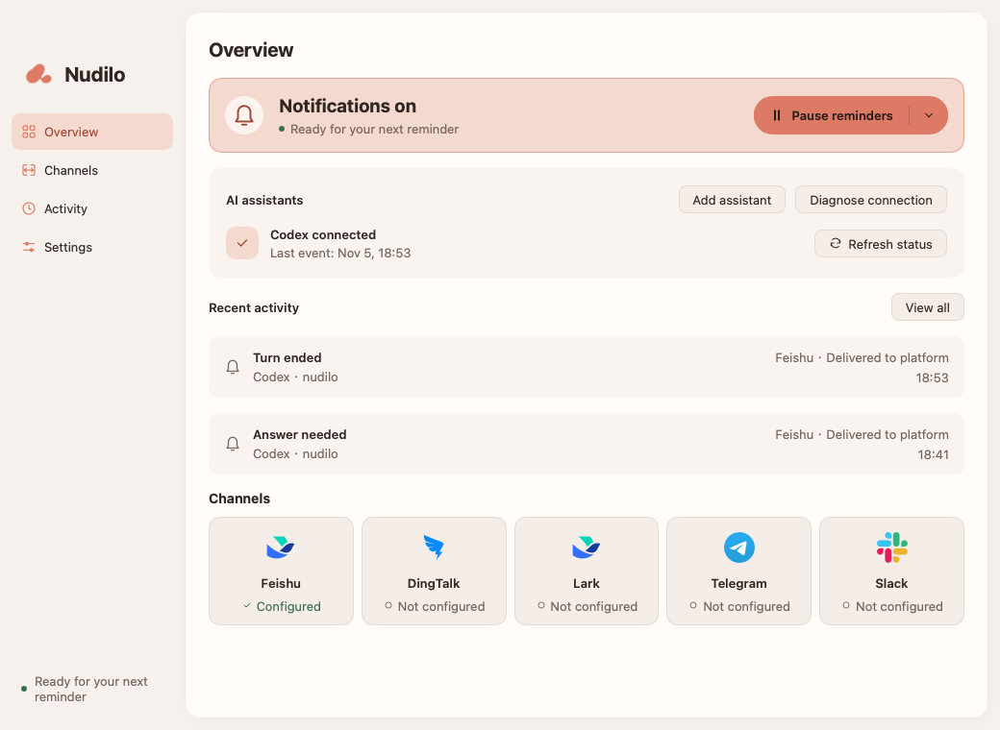
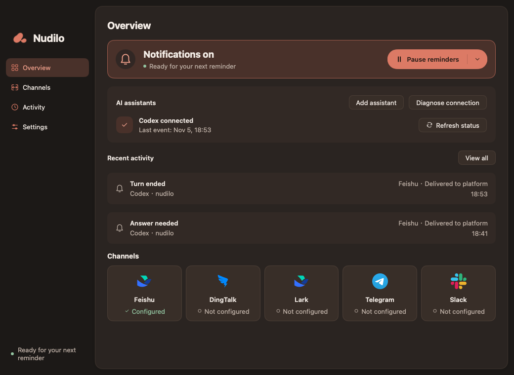

<p align="center">
  
</p>

# Nudilo

[English](README.md) · [简体中文](README.zh-CN.md)

**A little nudge from your AI.**

A native desktop companion that sends Codex and Claude Code notifications to your phone.
Install Nudilo, connect a channel, and step away while your AI assistant works.
Built with Go and [MyGo](https://mygo.egoist.dev/docs/ui) for macOS, Windows and Linux. No browser UI, npm or Node.js required.

**Nudilo** is pronounced **NOO-dee-loh** /ˈnuː.di.loʊ/, with stress on the
first syllable. It is a coined name inspired by **nudge**: a gentle reminder
that brings your attention back when it is needed. The name and slogan share
one idea: go about your day, and let your AI give you a little nudge when it
finishes a turn or needs your input.

[Installation](#installation) · [Get started](#get-started) · [Updates](#updates) · [Development](#development)



## Features

- Automatically finds local Codex and Claude Code, with independent connection controls.
- Notifies you when a turn ends, your assistant asks a question, or an action needs approval. Claude Code API failures have a separate Interrupted reminder.
- Supports **DingTalk, Feishu, Lark, Telegram and Slack**, with personal DMs or group/channel notifications. Enable multiple platforms at once.
- Coral theme with **System, Light and Dark** appearance.
- **English and Simplified Chinese**, following your system language by default. Switch instantly in Settings.
- Runs in the system tray with optional launch at login and **timed pauses** that survive restart.
- Three-step setup, connection diagnostics and separate test/real-event delivery status.
- Optional **project-to-channel routing**, searchable activity and assistant/status filters.
- Signed background updates, manual update checks and a restart when you choose.
- Credentials stay in encrypted local files. Content summaries are off by default.

<details>
<summary>Dark mode</summary>



</details>

## Installation

When a public release is available, open [GitHub Releases](https://github.com/cuikaipeng/nudilo/releases),
expand **Assets**, and download the installer for your system. `X.Y.Z` below
stands for the release version. You can also [build from source](#development).

| System | Architecture | Download |
| --- | --- | --- |
| macOS 12 or later | Apple Silicon and Intel, one universal app | `nudilo-X.Y.Z-macOS.dmg` |
| Windows | x64 | `nudilo-X.Y.Z-windows-amd64.exe` |
| Linux | x64 (`amd64`) or ARM64 (`arm64`) | `nudilo-X.Y.Z-linux-<arch>.deb`, or the matching `.tar.gz` plus `install.sh` |

The current macOS build uses **ad-hoc signing**, without an Apple Developer ID
certificate or Apple notarization. Windows installers are unsigned. Nudilo's
update-package signature is separate from OS publisher verification, so a valid
update signature does not remove first-launch OS warnings.

### macOS: install and open for the first time

For a manual upgrade, first choose **Quit Nudilo** from the running app's
menu-bar menu. Closing its window leaves it running.

1. Download and open the `.dmg` file.
2. Drag **Nudilo.app** into **Applications**. Run the installed copy, rather
   than the copy inside the disk image.
3. Open **Applications → Nudilo**.

If macOS blocks the app because its developer cannot be verified, and you
trust the download, you can allow this app through **System Settings → Privacy
& Security → Open Anyway**, then confirm. On macOS Monterey, look in **System
Preferences → Security & Privacy → General**.
See [Apple's first-launch instructions](https://support.apple.com/en-gb/102445).

Alternatively, for a trusted release blocked by its download quarantine
attribute, open **Terminal**, paste this command and press Return:

```sh
xattr -dr com.apple.quarantine "/Applications/Nudilo.app"
```

Then open Nudilo again from Applications. The command removes only the
quarantine attribute from this app and its contents. If you installed it in a
different folder, replace the quoted path with its actual location.

<details>
<summary>Permission errors or the app still will not open</summary>

If Terminal reports a permissions error and this is your own installation,
retry with administrator privileges:

```sh
sudo xattr -dr com.apple.quarantine "/Applications/Nudilo.app"
```

Enter your Mac login password when prompted; Terminal does not display the
characters. A “No such file” error means the app path is wrong or the app has
not yet been copied into Applications. A missing `com.apple.quarantine`
attribute means there is no quarantine marker to remove at that path.

This command does not repair damaged files or invalid code signatures. If the
app still fails, download it again and compare its SHA-256 with the release's
`SHA256SUMS`. For a managed Mac, follow your organization's installation policy.

</details>

### Windows

Run `nudilo-X.Y.Z-windows-amd64.exe` and follow the installer. If SmartScreen
shows a warning, verify that the file came from this project's release page.
For a download you trust, **More info → Run anyway** may be available. Device
policies or Smart App Control can prevent that option; see
[Microsoft's explanation](https://learn.microsoft.com/en-us/windows/apps/package-and-deploy/smartscreen-reputation).

### Linux

For Debian/Ubuntu-based systems, install the matching `.deb` using your
system's package installer. For a per-user installation, download the matching
`.tar.gz` and `install.sh` **from the same release into the same folder**, open a
terminal in that folder, and run:

```sh
sh install.sh
```

The script selects the local archive for your CPU architecture and installs
Nudilo in `~/.local/nudilo.app`, with an application-menu entry. Run it as your
normal user, without `sudo`. A user-owned tarball installation supports in-app
updates; system-managed packages should be upgraded using the package installer.

## Get started

Have Codex or Claude Code installed and run it at least once on this computer.
You only need the assistant you use; Nudilo also works with both installed.

1. Install and open Nudilo using the steps above.
2. Nudilo associates with local Codex and Claude Code automatically. Reopen existing Claude Code sessions to load the listeners. Existing Codex chats can send turn-ending reminders immediately; reopen them to enable answer and approval reminders too.
3. Open **Channels**, choose **Personal DM** or **Group / channel**, enter your bot configuration, pair your account for private messages, and choose **Save & test**.
4. Confirm the notification on your phone. Closing the window keeps Nudilo in the tray. On macOS, the Dock icon disappears until you reopen the window from the menu bar.

Reopening Nudilo skips notifications generated before startup and pending retries
from the previous run. They remain in Activity as **Skipped**; new reminders send normally.

| Platform | Personal DM | Group / channel |
| --- | --- | --- |
| Feishu / Lark | App ID + App Secret; pair by sending a private verification code. | Custom bot Webhook; optional signing secret. |
| DingTalk | Client ID + Client Secret; pairing discovers both your user ID and Robot Code. | Custom bot Webhook; optional signing secret. Allow both `Codex` and `Claude Code` for keyword validation. |
| Telegram | Bot Token from BotFather; open the bot to pair automatically. | Same bot; negative group Chat ID or channel @username. |
| Slack | Bot User OAuth Token (`xoxb-`); pair by sending a private verification code. | Incoming Webhook URL. |

Each platform has one active destination. Mode changes take effect when you save;
other-mode configuration remains in the local credential file. Existing group
configurations and Telegram private chats continue to work after upgrading. If your
group bot currently allows only the `Codex` keyword, add `Claude Code` to its
allowed keywords as well. Personal DMs need no new pairing.

The detailed [English setup guide](docs/CHANNELS.md) and [中文配置指南](docs/CHANNELS.zh-CN.md)
cover bot creation, exact fields and permissions, publishing, pairing, group IDs,
phone alerts and troubleshooting. Jump to your platform:
[Feishu](docs/CHANNELS.md#feishu) · [Lark](docs/CHANNELS.md#lark) ·
[DingTalk](docs/CHANNELS.md#dingtalk) · [Telegram](docs/CHANNELS.md#telegram) ·
[Slack](docs/CHANNELS.md#slack).

All five platforms identify personal recipients from a fresh private verification
code, without manual user-ID entry. Saved channels show a summary; **Edit setup**
opens prefilled fields with secrets masked. In-app **Setup help** provides a short
reference. Organizational availability and approval requirements still apply.

The first version sends **notifications only**. Answer questions and approve actions in the originating assistant on your computer. A turn ending does not imply that the entire task succeeded.

**Settings → Notification content → Customize** lets you edit the title and each
reminder's text, insert assistant/project/time/summary variables, preview messages and
restore defaults. All five platforms share these settings. Switch the preview between Codex and Claude Code; `{agent}` expands to the actual source. Notifications follow
the app language; English and Chinese customizations are saved independently.
Project names and optional summaries keep their original language.
See [customizing notifications](docs/CHANNELS.md#content).

See [Everyday use](docs/USAGE.md) for setup guidance, delivery health, timed pauses, project routing and activity filters.

## Updates

Automatic checking and downloading are **on by default**. Nudilo prepares a
verified update in the background and keeps sending reminders. Choose
**Restart to update** when you are ready; it does not restart automatically.

To check manually, use **Settings → Updates**, **Nudilo → Check for updates** on
macOS (**File → Check for updates** on Windows/Linux), or the menu-bar/tray menu.
With automatic updates off, choose **Check for updates →
Download update → Restart to update**.

Read-only or system-package installations still check versions and offer the
official download page. If no public update is available, Nudilo says so.
Older builds without an updater need one manual installation of an
update-enabled version. See [update behavior and release setup](docs/UPDATES.md).

## Privacy and compatibility

- By default, notifications contain the assistant name, project folder name, event type and time. Summaries, when enabled, contain at most 500 characters. Secret-input questions are excluded.
- Webhooks, app credentials, recipient identifiers and tokens are saved locally using AES-GCM (`credentials.vault` and `credentials.key`). macOS/Linux files use `0600` permissions; Windows inherits the user-data directory's access controls. Nudilo does not access an OS credential store.
- The local event helper queues events without making network requests or approving actions. Nudilo sends them in the background and retries transient failures per channel.
- Local Codex must support `Stop`, `PreToolUse` and `PermissionRequest` Hooks. Natural-language questions without a structured input request are reported as a turn ending. Organization policies are respected.
- Claude Code requires 2.1.78+ on macOS/Linux or 2.1.295+ on Windows. It uses local command hooks; organization policies are respected. See [Claude Code setup and limits](docs/BEHAVIOR.md#claude-code).
- Remote hosts, containers and independent WSL installations are not automatically associated.

See [Behavior and data](docs/BEHAVIOR.md) for queue handling, data locations and compatibility details.

## Development

Requires **Go 1.27.3** and **Python 3.9+**. MyGo is pinned to **v0.7.4** in `go.mod`.
These tools are for development and packaging; installer users do not need them.

Development happens on the default `dev` branch; pushes and PRs run checks only.
A release PR from `dev` to `main`, with both version files bumped, automatically
builds, verifies, tags and publishes the new version. See the
[release workflow](docs/RELEASING.md#version-and-github-workflow).

```sh
git clone https://github.com/cuikaipeng/nudilo.git
cd nudilo
./script/build_and_run.sh
```

On Windows, use `./scripts/dev.ps1` from PowerShell. These development scripts
prepare the assets and event helper, then start MyGo's development mode without
requiring a release signing key. Rerun the script after changing helper code.

Common checks and packaging commands:

```sh
make check                 # Go/UI/i18n and release tests, vet, version checks
make race                  # Race detector
make package               # Installer for the current OS; universal on macOS
PLATFORM=darwin/universal,windows/amd64,linux/amd64,linux/arm64 make package
```

Windows PowerShell:

```powershell
./scripts/build.ps1 -Platform windows/amd64
```

Verified installers and `SHA256SUMS` are collected in `dist/release/`.
Packaging requires the matching update signing key; see [release-key setup](docs/UPDATES.md#release-signing-setup).
Packaging builds a temporary source copy and verifies architecture, versions, resources, licenses and bundle languages.

- [Contributing](CONTRIBUTING.md)
- [Builds, signing and releases](docs/RELEASING.md)
- [Translations](docs/I18N.md)

## Acknowledgements

Nudilo's desktop layout and release workflow draw on [Kivrix](https://github.com/cuikaipeng/kivrix).
Its native UI is built with MyGo. The approved TOUCH logo and brand records live in [design/brand](design/brand/README.md).

Nudilo's own code is [MIT licensed](LICENSE). Third-party components retain their
own licenses; [complete notices and covered source](THIRD_PARTY_NOTICES.md) are
included in every installer. See the [licensing review](docs/LICENSING.md).
Service names and marks identify integrations and do not imply endorsement.
