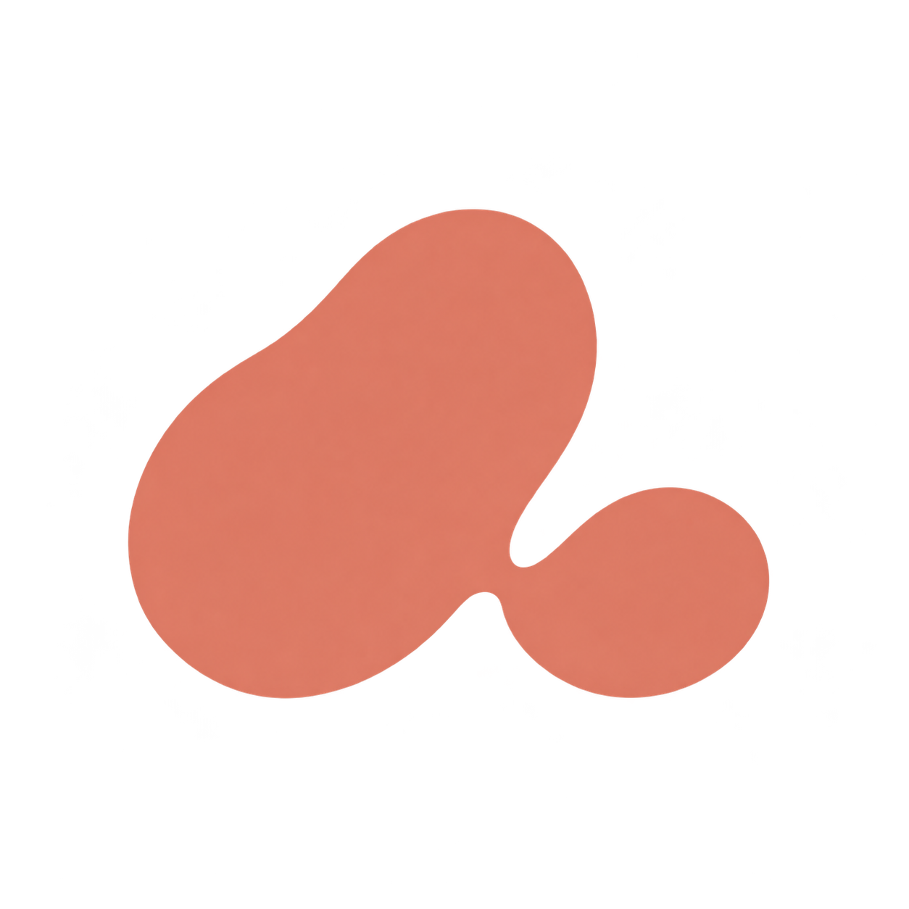
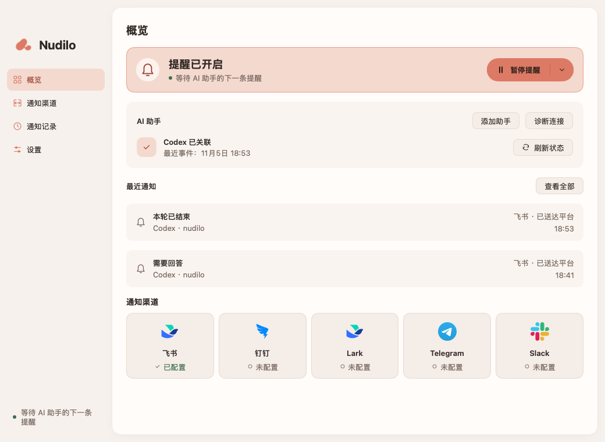
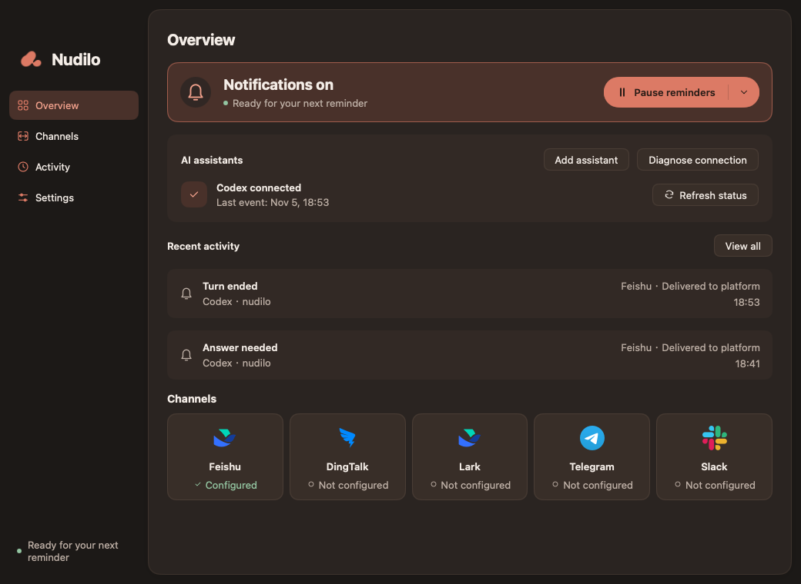

<p align="center">
  
</p>

# Nudilo

[English](README.md) · [简体中文](README.zh-CN.md)

**A little nudge from your AI.**

把 Codex 和 Claude Code 的提醒发送到手机的原生桌面助手。安装 Nudilo、配置通知渠道，就可以放心去忙别的。
使用 Go 和 [MyGo](https://mygo.egoist.dev/docs/ui) 开发，支持 macOS、Windows 和 Linux，无需浏览器界面、npm 或 Node.js。

**Nudilo** 读作 **NOO-dee-loh**，音标为 **/ˈnuː.di.loʊ/**，近似「**努·迪·洛**」，
重音在第一个音节。它是一个受 **nudge**（轻轻推一下、温和地提醒）启发的自造词。
名字和 **A little nudge from your AI.** 表达的是同一个想法：你可以先去忙自己的事，
等 AI 完成本轮工作或需要你回应时，再轻轻提醒你一下。

[安装](#安装) · [开始使用](#开始使用) · [更新](#更新) · [开发](#开发)



## 功能

- 自动识别本机 Codex 和 Claude Code，分别查看、刷新和管理关联状态。
- 本轮结束、需要回答或需要授权时发送提醒；Claude Code 的 API 错误单独显示为「异常中断」。
- 支持 **钉钉、飞书、Lark、Telegram、Slack** 的个人私聊与群聊／频道提醒，可同时启用多个平台。
- 珊瑚色主题，支持**跟随系统、浅色和深色**外观。
- 支持**英文和简体中文**，默认跟随系统语言，可在设置中即时切换。
- 系统托盘运行、登录时启动、暂停提醒和投递记录。
- 带签名校验的后台更新与手动检查，由你选择何时重启。
- 凭据保存到本地加密文件，默认不发送内容摘要。
- 三步首次配置引导、连接诊断，分别展示测试消息和真实事件的发送状态。
- 支持 15 分钟、1 小时、明天上午或手动恢复的暂停方式，重启后保留恢复时间。
- 可按项目和助手选择渠道，通知记录支持项目搜索、助手/状态筛选及日期分组。

<details>
<summary>深色模式</summary>



</details>

## 安装

公开发布后，前往 [GitHub Releases](https://github.com/cuikaipeng/nudilo/releases)，
展开 **Assets**，下载对应系统的安装包。下表中的 `X.Y.Z` 代表版本号。
也可以[从源码构建](#开发)。

| 系统 | 架构 | 下载文件 |
| --- | --- | --- |
| macOS 12 或更新版本 | Apple Silicon 与 Intel 共用一个通用版本 | `nudilo-X.Y.Z-macOS.dmg` |
| Windows | x64 | `nudilo-X.Y.Z-windows-amd64.exe` |
| Linux | x64（`amd64`）或 ARM64（`arm64`） | `nudilo-X.Y.Z-linux-<arch>.deb`，或对应的 `.tar.gz` 与 `install.sh` |

目前 macOS 包使用 **ad-hoc 临时签名**，没有 Apple Developer ID 证书，也尚未经过
Apple 公证；Windows 安装包未签名。Nudilo 更新包自身的签名校验与操作系统的开发者
身份验证是两回事，因此首次打开时仍可能出现系统提示。

### macOS 安装与首次打开

如果要手动覆盖旧版本，请先从正在运行的应用的菜单栏菜单选择「退出 Nudilo」；
只关闭窗口仍会在后台运行。

1. 下载并打开 `.dmg` 文件。
2. 将 **Nudilo.app** 拖入**应用程序**，之后运行这里的副本，不要直接在磁盘映像里运行。
3. 在「应用程序」中打开 Nudilo。

如果 macOS 因为无法验证开发者而拦截应用，且你确认下载来源可信，可以打开
**系统设置 → 隐私与安全性 → 仍要打开**并确认。macOS Monterey 对应的位置是
**系统偏好设置 → 安全性与隐私 → 通用**。
可参考 [Apple 的首次打开说明](https://support.apple.com/zh-cn/102445)。

对于可信安装包因下载隔离标记造成的拦截，也可以打开**终端**，粘贴以下命令并回车：

```sh
xattr -dr com.apple.quarantine "/Applications/Nudilo.app"
```

然后回到「应用程序」重新打开 Nudilo。这个命令只删除 Nudilo 应用及其内部文件的下载
隔离标记。如果你安装在其他文件夹，请将引号内的路径替换成实际安装位置。

<details>
<summary>提示权限不足，或执行后仍无法打开</summary>

如果终端提示权限不足，且这是你自己的安装，可以使用管理员权限重试：

```sh
sudo xattr -dr com.apple.quarantine "/Applications/Nudilo.app"
```

按提示输入 Mac 登录密码；输入过程中终端不会显示密码字符。
出现「No such file」表示路径不正确，或还没有把应用拖入「应用程序」。
提示没有 `com.apple.quarantine` 属性，表示对应路径已没有需要移除的隔离标记。

这个命令不能修复真正损坏的文件或无效的代码签名。如果仍无法启动，请重新下载，
并对照该版本的 `SHA256SUMS` 核对文件。公司管理的 Mac 请遵循组织的安装策略。

</details>

### Windows

运行 `nudilo-X.Y.Z-windows-amd64.exe`，按安装向导操作。如果出现 SmartScreen 提示，
先确认安装包来自本项目的发布页；对于可信下载，可在提供该选项时选择
「更多信息 → 仍要运行」。设备策略或智能应用控制可能不提供继续运行的选项，
详见 [Microsoft 说明](https://learn.microsoft.com/en-us/windows/apps/package-and-deploy/smartscreen-reputation)。

### Linux

Debian／Ubuntu 系统可以通过系统的软件包安装器安装对应架构的 `.deb`。
如果希望安装到用户目录，请将**同一版本**、对应架构的 `.tar.gz` 和 `install.sh`
下载到**同一个文件夹**，在该文件夹打开终端，执行：

```sh
sh install.sh
```

脚本会选择本机架构对应的本地压缩包，将 Nudilo 安装到 `~/.local/nudilo.app`，
并添加应用菜单入口。请以普通用户运行，不要加 `sudo`。用户目录中的 tar.gz 安装支持
应用内更新；由系统管理的软件包应继续通过软件包安装器升级。

## 开始使用

先在这台电脑上安装并运行过 Codex 或 Claude Code。只需要安装你使用的助手，
也可以同时使用两者。

1. 按照上面的步骤安装并打开 Nudilo。
2. Nudilo 自动关联本机 Codex 和 Claude Code。已有 Claude Code 会话请重新打开以加载监听；已有 Codex 会话可直接接收结束提醒，重新打开后还能启用回答和授权提醒。
3. 在「通知渠道」选择「个人私聊」或「群聊 / 频道」，填写机器人配置；私聊模式先绑定账号，再点击「保存并测试」。
4. 确认手机收到消息。关闭窗口后，Nudilo 会继续在托盘运行。macOS 上会同时隐藏 Dock 图标，从菜单栏重新打开窗口时恢复。

退出后重新启动时，启动前产生的提醒和上次遗留的待重试记录会在通知记录中标为
「已跳过」，不再补发；启动后的新提醒正常发送。

| 平台 | 个人私聊 | 群聊 / 频道 |
| --- | --- | --- |
| 飞书 / Lark | App ID、App Secret；私聊发送验证码后自动识别账号。 | 自定义机器人 Webhook；可选签名密钥。 |
| 钉钉 | Client ID、Client Secret；自动识别用户 ID 和 Robot Code。 | 自定义机器人 Webhook；可选加签密钥。关键词校验同时允许 `Codex` 和 `Claude Code`。 |
| Telegram | BotFather 的 Bot Token；打开机器人后自动绑定。 | 同一机器人；填写负数群聊 Chat ID 或频道 @用户名。 |
| Slack | 机器人 OAuth Token（`xoxb-`）；私聊发送验证码后自动识别账号。 | Incoming Webhook URL。 |

每个平台同时使用一个接收目标，切换方式后点击保存生效。另一种方式的配置仍保留在本地凭据文件中；升级后，原有群聊配置和 Telegram 私聊可以继续使用。群机器人如果原来只允许 `Codex` 关键词，请再加入 `Claude Code`；个人私聊无需重新绑定。

详细的[中文配置指南](docs/CHANNELS.zh-CN.md)和 [English setup guide](docs/CHANNELS.md)覆盖机器人创建、字段与权限、发布审批、账号绑定、群 ID 获取、手机提醒及常见问题。按平台直达：[飞书](docs/CHANNELS.zh-CN.md#feishu) · [Lark](docs/CHANNELS.zh-CN.md#lark) · [钉钉](docs/CHANNELS.zh-CN.md#dingtalk) · [Telegram](docs/CHANNELS.zh-CN.md#telegram) · [Slack](docs/CHANNELS.zh-CN.md#slack)。

五个平台都通过当前私聊验证码识别接收账号，无需手填接收人 ID。已配置渠道显示概览，点击「编辑配置」自动填入已有内容，密钥保持遮挡。应用内「配置帮助」提供简要步骤；企业应用仍受可用范围和组织审批策略约束。

第一版**只发送通知**。需要回答或授权时，请回到电脑上的对应 AI 助手处理。本轮结束不等于整个任务成功。

在「设置 → 通知文案 → 自定义」可以修改标题和四类提醒的正文，插入 AI 助手、项目、时间、摘要变量，实时预览或恢复默认。预览可切换 Codex 和 Claude Code，`{agent}` 自动替换为实际来源。五个平台共用文案；通知跟随软件语言，中英文自定义内容分别保存。项目名和可选的摘要保留原文。详见[通知文案设置](docs/CHANNELS.zh-CN.md#content)。

日常操作见[使用指南](docs/USAGE.zh-CN.md)：首次引导、发送状态、连接诊断、定时暂停、项目分流和通知筛选。

## 更新

默认开启**自动检查和下载更新**。Nudilo 在后台验证并准备新版本，期间继续发送提醒；
准备好后，由你点击「重启更新」，不会自动重启。

可以在「设置 → 更新」、macOS 的「Nudilo → 检查更新」（Windows/Linux 为
「文件 → 检查更新」），或菜单栏／托盘菜单中手动检查。
关闭自动更新后，按「检查更新 → 下载更新 → 重启更新」操作即可。

只读位置或系统软件包安装仍能检查版本，并提供官方下载入口。尚无可用的公开更新时，
界面会明确说明。没有更新功能的旧版本，需要先手动安装一次支持更新的版本。
详细行为及首次发版配置见[自动更新说明](docs/UPDATES.zh-CN.md)。

## 隐私与兼容性

- 默认仅发送助手名称、项目目录名、提醒类型和时间。启用摘要后最多发送 500 字；秘密输入问题不会进入摘要。
- Webhook、应用凭据、接收账号和 Token 使用 AES-GCM 保存在本地的 `credentials.vault` 和 `credentials.key` 中。macOS/Linux 文件权限为 `0600`；Windows 继承用户数据目录的访问控制。Nudilo 不访问系统凭据库。
- 本地事件助手仅写队列，不联网、不批准操作。Nudilo 在后台发送消息，按渠道重试临时失败。
- 本地 Codex 需要支持 `Stop`、`PreToolUse` 和 `PermissionRequest` Hooks。普通回复中的自然语言问题归为本轮结束。不会绕过组织策略。
- Claude Code 在 macOS/Linux 上需要 2.1.78 或更新版本，Windows 上需要 2.1.295 或更新版本，通过本地 hooks 接入并遵守组织策略。详见[Claude Code 关联说明](docs/BEHAVIOR.md#claude-code-zh)。
- 不自动关联远程主机、容器或独立 WSL 环境中的助手。

队列处理、数据位置及兼容性说明见[运行与数据](docs/BEHAVIOR.md)。

## 开发

需要 **Go 1.27.3** 和 **Python 3.9+**，MyGo 固定为 **v0.7.4**。
这些工具仅供开发与打包使用，下载安装包的用户不需要安装。

日常开发在默认的 `dev` 分支进行，提交和 PR 只运行检查。准备发版时同时提高两个版本
文件中的版本号，再合并 `dev` → `main` 的发布 PR，即会自动构建、验证、打标签并正式发布。
详见[发布流程](docs/RELEASING.md#中文摘要)。

```sh
git clone https://github.com/cuikaipeng/nudilo.git
cd nudilo
./script/build_and_run.sh
```

Windows 请在 PowerShell 中运行 `./scripts/dev.ps1`。开发脚本会先准备资源并编译
事件助手，再启动 MyGo 开发模式，无需发布签名私钥。修改事件助手代码后请重新运行脚本。

常用检查与打包命令：

```sh
make check                 # Go、UI、多语言、发布脚本测试与静态检查
make race                  # 数据竞争检查
make package               # 当前系统安装包；macOS 默认通用架构
PLATFORM=darwin/universal,windows/amd64,linux/amd64,linux/arm64 make package
```

Windows PowerShell：

```powershell
./scripts/build.ps1 -Platform windows/amd64
```

验证后的安装包和 `SHA256SUMS` 位于 `dist/release/`。打包在临时源码副本中完成，并检查架构、版本、资源、许可及系统语言声明。
打包还需要匹配的更新签名私钥，详见[首次发版配置](docs/UPDATES.zh-CN.md#首次发布前的配置)。

- [贡献说明](CONTRIBUTING.md)
- [构建、签名与发布](docs/RELEASING.md)
- [翻译维护](docs/I18N.md)

## 致谢

桌面布局和发布流程参考 [Kivrix](https://github.com/cuikaipeng/kivrix)，原生 UI 基于 MyGo。
已定稿的 TOUCH Logo 与设计记录位于 [design/brand](design/brand/README.md)。

Nudilo 自有代码采用 [MIT 许可](LICENSE)。第三方组件保留各自的许可；每个平台的安装包都附带
[完整许可文本及相关源码](THIRD_PARTY_NOTICES.md)。详见[开源许可检查](docs/LICENSING.zh-CN.md)。
平台名称和图标用于说明集成关系，不表示官方背书。
